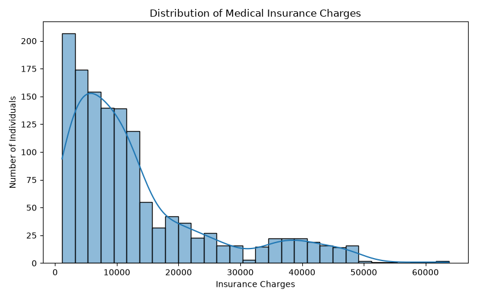
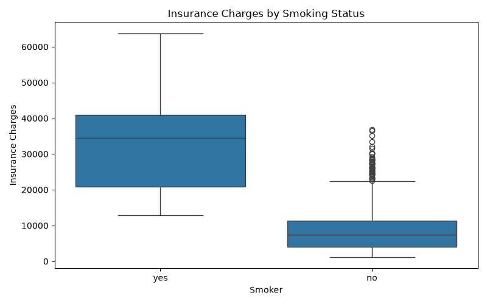
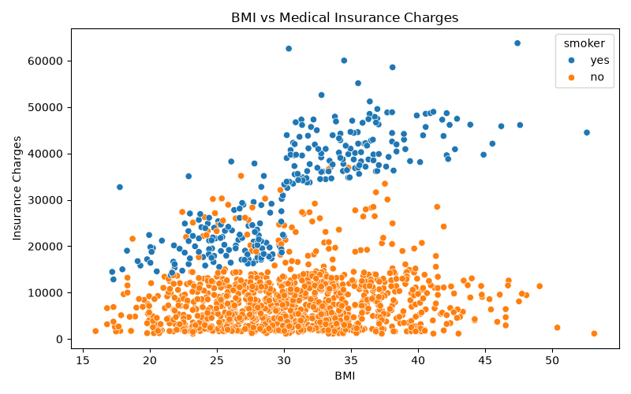
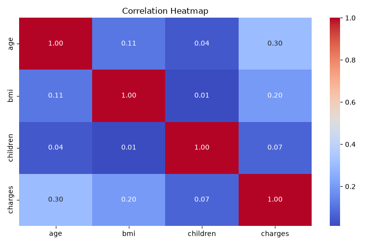
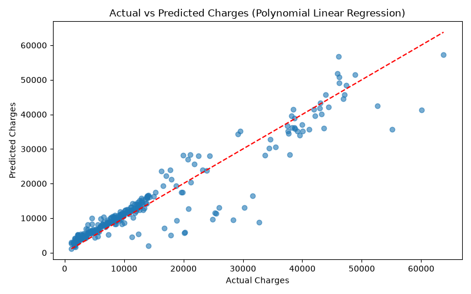
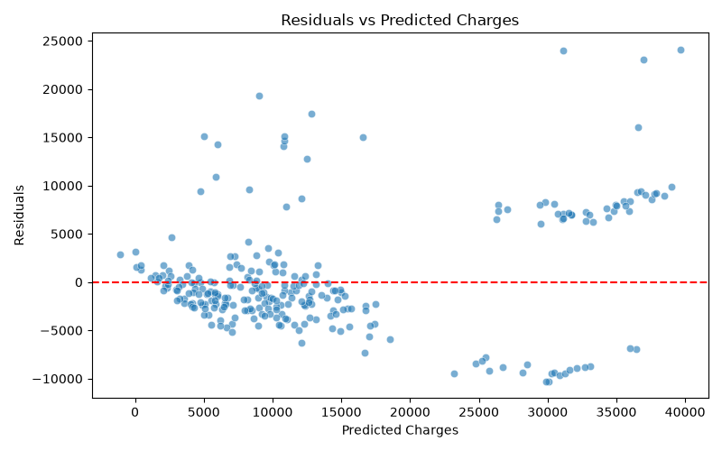

# -AIML-Project-RollNo-2024312
Medical Insurance Cost Prediction using Linear Regression
# Medical Insurance Cost Prediction

## Problem Statement

Medical insurance charges vary from person to person depending on factors such as age, BMI, smoking status, gender, number of children, and region. This project uses Machine Learning to predict individual medical insurance costs based on these factors.

The aim is to understand which features influence insurance charges and build a model that can estimate medical expenses.

## Dataset

- **Name:** Medical Cost Personal Dataset
- **Source:** Kaggle
- **Link:** https://www.kaggle.com/datasets/mirichoi0218/insurance
- **Rows / Columns:** 1,338 rows and 7 columns
- **Cleaned Dataset:** 1,337 rows after removing one duplicate record.

## Tools Used

- Python
- Pandas
- NumPy
- Matplotlib
- Seaborn
- Scikit-learn
- Jupyter Notebook

## Workflow

1. **Data Collection:** Downloaded the Medical Cost Personal Dataset from Kaggle.
2. **Data Cleaning:** Checked missing values, removed duplicate records, and verified the dataset.
3. **Exploratory Data Analysis (EDA):** Used graphs and statistical analysis to understand the data and identify patterns.
4. **Feature Engineering:** Applied One-Hot Encoding to categorical features and generated polynomial features of degree 2.
5. **Model Building:** Tested three approaches:
   - Linear Regression
   - Log-Transformed Linear Regression
   - Polynomial Linear Regression (Degree 2)
6. **Evaluation:** Compared the models using R² Score, Mean Absolute Error (MAE), and Root Mean Squared Error (RMSE).
7. **Insights & Recommendations:** Analysed feature importance and identified the major factors associated with insurance charges.

## Results

- **Final Model:** Polynomial Linear Regression (Degree 2)

- **Key Metrics:**
  - R² Score: 0.8825
  - MAE: 2867.32
  - RMSE: 4646.06

### Model Comparison

| Model | R² Score | MAE | RMSE |
|---|---:|---:|---:|
| Linear Regression | 0.8069 | 4177.05 | 5956.34 |
| Log-Transformed Linear Regression | 0.7181 | 3755.93 | 7197.03 |
| Polynomial Linear Regression | 0.8825 | 2867.32 | 4646.06 |

Polynomial Linear Regression performed best among the three tested approaches.

### Top Factors / Drivers

1. **Smoking Status:** Smoking status had the highest permutation importance. Average charges were approximately 32,050 for smokers and 8,441 for non-smokers.
2. **BMI:** BMI was the second most important feature and showed a positive relationship with insurance charges.
3. **Age:** Age also showed a positive relationship with insurance charges.

These findings describe patterns in the dataset and do not establish cause-and-effect relationships.

## Screenshots

### 1. Distribution of Insurance Charges

### 2. Insurance Charges by Smoking Status

### 3. BMI vs Insurance Charges

### 4. Correlation Heatmap

### 5. Polynomial Regression: Actual vs Predicted

### 6. Residuals vs Predicted

## Future Improvements

- Try other Machine Learning models such as Random Forest and compare their performance.
- Apply cross-validation for more reliable model evaluation.
- Explore larger and more diverse datasets.
- Deploy the trained model as a simple web application for predicting insurance costs.

## Author

**Gauri Ghansela**  
B.Sc. (Hons.) Computer Science  
University of Delhi